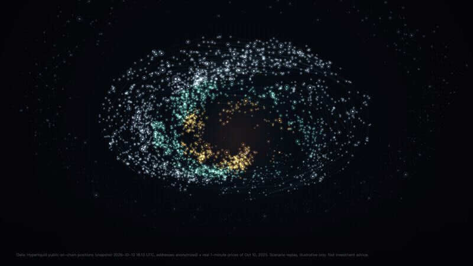
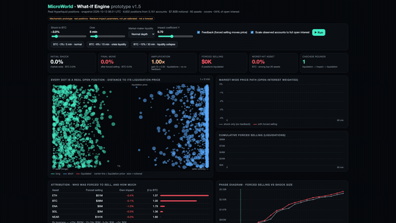

# MicroWorld

**A world model of finance, starting where every position is public.**

On October 10, 2025, more than $19 billion of crypto positions were liquidated in a single day. Every venue saw its own book; no one saw how the forced selling would chain together.

On-chain exchanges change that. On Hyperliquid, every account's positions, leverage and liquidation price are public. **MicroWorld reconstructs that state and simulates how a shock cascades through it, using real accounts instead of assumptions.**

▶ [Watch the 1-minute Star Map demo](assets/MicroWorld_Star_Map_demo.mp4) · *The Star Map replays a snapshot of 3,710 real positions across 2,347 accounts (Oct 10, 2026) against the real minute-by-minute prices of October 10, 2025. It is a scenario replay, not a record of who was liquidated that day.*

---

## What it does today

**Star Map.** Every star is a real open position on Hyperliquid. Replay a crash, minute by minute, against real historical prices: as the price falls, positions cross their liquidation prices and burn out, and cumulative liquidations climb.

**What-If Engine.** Pick a shock, for example BTC −8% over 15 minutes under stressed liquidity. The engine checks every position against its liquidation price, aggregates the forced selling, moves prices, and repeats until the market settles.

| What-If Engine, one public snapshot (Oct 13, 2026) | |
|---|---|
| Accounts with open positions | ~3,100 |
| Positions | ~8,800 |
| Notional | ~$7.8B, about a third of the venue's open interest |
| Example shock: BTC −8% in 15 min, stressed liquidity | market move −9.7% → about −11.7% once forced liquidations feed back |

*Simulation on real positions with literature-standard parameters. It is an illustration, not a forecast.*

## The idea: AI agents playing the market game

We are building MicroWorld so that every market participant is played by an LLM-driven AI agent: a whale, a market maker, a 20x-leverage trader, a lending vault. Each agent stands in for one real participant, with that participant's real positions, leverage and limits, and a behavior calibrated to what it actually did. The agents trade, hedge, panic and get liquidated against each other. Prices and crashes emerge from their game instead of being assumed.

A market is a game played under hard rules: margin, liquidation and risk limits. MicroWorld puts every player into that game.

We build it in two stages.

**Stage 1: Web3, where the game is visible.**
On-chain exchanges publish every account's positions, leverage and liquidation price. That lets us reverse-engineer the players. We reconstruct each account's state, learn how it actually behaves from its on-chain history, and turn it into an agent. Then we check the simulated agents against what really happened. Web3 is our wind tunnel: the one place where a multi-agent simulation of finance can be tested against ground truth.

- Near-term product: crypto risk infrastructure. Venues, lenders and stablecoin issuers each see just their own book. We give them a neutral, cross-venue view of where forced selling sits and how much it amplifies.

**Stage 2: all of finance, where the game is hidden.**
On-chain markets are still a small slice of global finance. In traditional markets the players' positions are private, but the rules of the game are similar, and the method tested in Stage 1 carries over. Participants are inferred from public filings, mandates and aggregate market data, then calibrated the same way.

- Long-term goal: a world model of finance, where any important financial decision can be simulated before the market sees it.

## About

Built by [AlphaFlow](https://microworldmarkets.com), founded by students from HKUST, NUS and HKU. Pre-revenue.

- Website: https://microworldmarkets.com
- Contact: alphaflow.fintech@outlook.com

*This repository is a public showcase. The engine itself is closed-source.*

> **History.** MicroWorld began as an open-source research repo (a multi-agent world model of equity markets), which reached 512 stars on GitHub. In October 2026 we took it private to focus on commercialization; this showcase replaces it as our public page.
